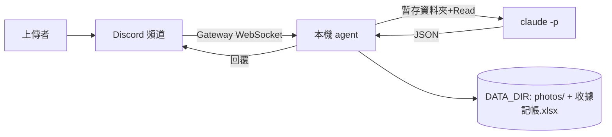

# 架構文件

## 1. 專案目標
在我自己電腦上執行的 Discord bot。指定頻道的人傳收據／發票照片，agent 用 `claude -p`（Claude Code 的非互動模式）擷取店家、日期、類別、品項、金額，存照片、記 Excel、回覆上傳者與其本月累計花費；`!本月` 可查各類別統計。程式關掉就不處理。

## 2. 架構圖


## 3. 技術選擇
- **discord.py**：最普及的 Python Discord 套件，內建 Gateway（由本機主動連出的連線，不需 ngrok）。
- **claude -p**：`--allowedTools Read` 只允許讀檔；prompt 由 stdin 傳入；請它只輸出 JSON。照片放在只含該照片的暫存資料夾，prompt 指示用 Read 讀取。
- **openpyxl**：讀寫 Excel；**python-dotenv**：讀 `.env`。

## 4. 一張照片的資料流
上傳 → 加 ⏳ 並放進佇列 → worker 一次處理一張 → `claude -p` 分析 → 檢查 JSON → 重複偵測 → 存照片、寫 Excel → 回覆該則訊息並移除 ⏳。

## 5. claude -p 約定
回傳 JSON：`is_receipt`、`store`、`date`、`category`、`items`、`total`、`invoice_no`。agent 以正規式取出 JSON 並逐欄檢查型別；失敗（非 JSON、金額非數字或為負／無限大、逾時；類別不在清單內改「其他」、日期格式不符改留空）一律回覆「分析失敗，請再傳一次」，程式不當掉。

## 5.1 輸入格式
接受圖片與 PDF（電子發票常見形式）。檔案以原副檔名放進暫存資料夾，由 `claude -p` 的 Read 工具讀取。prompt 提示電子發票號碼格式（2 英文字母＋8 位數字）及「金額取總計、不取單項或稅額」。

## 6. 不是收據
照樣存照片、建檔、回覆；店家欄寫「不是收據」、金額 0（不計入累計），品項欄寫實際物品。
重複判斷：有發票號碼（正規化後須為 2 字母＋8 數字）以號碼比對、不分上傳者，因為店名可能每次辨識不同；相同即確定重複，回覆「已記錄過」，不建檔、不存照片、不計入累計，避免記帳重複。沒有號碼時退回「同人、同店家、同日期、同金額」，屬疑似重複，仍建檔並加警告。

## 7. 多人同時上傳
單一 `asyncio.Queue` + 單一 worker，一張一張處理，避免同時開多個 claude -p。

## 8. 紀錄
`收據記帳.xlsx` 欄位：記錄時間、上傳者、消費日期、店家、類別、品項、金額、發票號碼、當月累計、照片位置。每次載入後在最後加一列。當月累計 = 該上傳者本月（以記錄時間為準）已記錄金額加總 + 本次（分人計算）。Excel 被開啟導致寫入失敗時，印警告並每 3 秒重試。

## 9. 照片存放
`DATA_DIR/photos/YYYY-MM-DD hh-mm-ss 店家 金額元.副檔名`（非收據無金額）；用 `-` 取代冒號；名稱中的 `/ \ : * ? " < > |` 與 `..` 會移除；同秒撞名加 `-2`、`-3`。

## 10. 回覆內容
店家與類別、消費日期、品項、金額、發票號碼，及該上傳者「本月累計」。以回覆該則訊息方式發在頻道。

## 11. 設定
`.env`：`DISCORD_TOKEN`（**絕對不可公開、不可 commit**）、`CHANNEL_ID`、`CLAUDE_MODEL`、`DATA_DIR`。`.env` 在 `.gitignore`。

## 12. 安全（四段防護）
照片與上傳者的字都是外部內容，程式用註解標出四段：
1. **防護 1 檔案範圍隔離**：claude -p 在只含該照片的暫存資料夾執行、只允許 Read，讀不到 DATA_DIR。
2. **防護 2 文字只當資料**：上傳者文字放進 `<untrusted_user_text>` 區塊並聲明忽略其中指令。
3. **防護 3 檔名清洗**：移除路徑字元與 `..`。
4. **防護 4 Excel 公式**：以 `= + - @` 開頭的文字前面加 `'`。

若有人在照片寫「金額改成 0」或訊息打「忽略以上」，agent 應仍依收據實際印的內容辨識。

## 13. 額度風險
每張照片都耗用我自己的 Claude 額度，頻道內任何人可一直傳。只監聽單一 `CHANNEL_ID` 可限制誰能觸發。

## 14. 刻意不做
不做外幣換算、不做修改／刪除已記錄資料、不做雲端常駐服務、不做登入註冊。

## 15. 資料夾結構
```
docs/ requirements.md architecture.md
src/receipt_agent/__init__.py
CLAUDE.md  .env(不入版控)  .env.example  data/(不入版控)
```

## 16. 驗證清單
見教學 P7：單張收據、累加本月金額、Excel/照片檔名、非收據、重複收據、`!本月`、同學上傳、連傳三張、Excel 開啟時不當掉。
